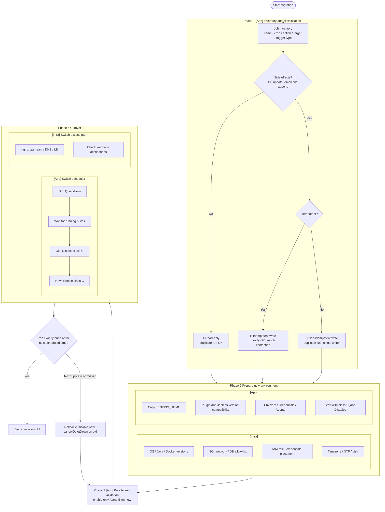

# Migrating Jenkins scheduled jobs without duplicate or missed executions

## 1. Purpose

Scheduled (cron) jobs are a key risk in Jenkins migration.
Copying JENKINS_HOME also copies the triggers.
So the old and new servers can run the same job.

## 2. Glossary

| Term | Japanese | Meaning |
|---|---|---|
| Idempotency | 冪等性 | Running it many times gives the same result as running it once |
| Side effect | 副作用 | Changes external state (DB update, email, file append, payment) |
| Read-only | 参照系 | Does not change state |
| Mutating | 更新系 | Changes state |
| Duplicate execution | 二重実行 | Same job runs on two environments or processes |
| Missed execution (misfire) | 実行漏れ | A scheduled run does not happen during the switch |
| Mutual exclusion (mutex) | 排他制御 | Only one runs at a time |
| Distributed lock | 分散ロック | Mutual exclusion across servers |
| Single writer | 単一書き込み元 | Only one place may update the data |
| Parallel run | 並行稼働 | Old and new run at the same time for validation |
| Cutover | 切り替え | Moving production work from old to new |
| Active-Passive | アクティブ・パッシブ | Only one side is active |
| Disabled state | 無効化状態 | The job exists but its triggers do not fire |

## 3. Job classification

| Class | Characteristics | Examples | Duplicate run | Handling |
|---|---|---|---|---|
| A Read-only | Does not change state | Disk check, health check | OK | Can run in parallel |
| B Idempotent write | Overwrite with the same value, UPSERT | UPSERT, overwrite with the same value | Basically OK | Watch load and contention |
| C Non-idempotent write | Changes state differently on each run | Counter increment, email, numbering, billing, delete | NG | Single writer |
| D Order-dependent | Night batch "B after A" | Night batch "B after A" | Conditional | Align time and dependencies |

Classify by what the job does, not by its name.

- `SET count = count + 1` is non-idempotent.
- `SET status = 'DONE'` is idempotent.

## 4. Flowchart

## 5. Application vs Infrastructure

| Item | Layer | Reason |
|---|---|---|
| Job inventory and classification | App | Decided by what the job does |
| cron Disable / Enable | App | Setting inside Jenkins |
| Quiet down | App | State inside Jenkins |
| Plugins, Credentials, env vars | App | Stored in JENKINS_HOME |
| OS, Java, Docker versions | Infra | Server configuration |
| SG, DB allow-list, IAM | Infra | Network and permissions |
| nginx / DNS / LB switch | Infra | Access path setting |
| Timezone | Infra (affects App) | Different timezones change cron execution time |

## 6. Design points to prevent duplicate execution

| Point | Method | Example |
|---|---|---|
| Migrate in disabled state | Bring class C jobs to new already Disabled; Enable them only at cutover | Disabled flag is part of the job config in JENKINS_HOME |
| Single active scheduler | Active-Passive; keep triggers disabled on new | Quiet down old, Disable on new |
| Cutover order | Stop old first, then enable new | Reverse order causes duplicates |
| Concurrency control | "Do not allow concurrent builds", Lockable Resources plugin | |
| Job-side exclusion | DB advisory lock, conditional write | Exit if already running |
| Make jobs idempotent | Idempotency key, unique constraint, processed flag | "Once per day" enforced in DB |
| Transaction | Group updates in one transaction | No half-finished state |
| Evidence | Log processed count/time in a result table | Confirm exactly-once after cutover |

## 7. Pitfalls

- Copying JENKINS_HOME also copies cron triggers, so new runs the same schedule.
- Migrate class C jobs in disabled state. If they arrive enabled, new may run them as soon as it starts.
- Enabled/disabled is a per-job setting that is copied as it is. A job that is enabled on old arrives enabled on new.
- `H` in cron may produce the same time on both servers for the same job name.
- Quiet down can be cleared by a restart. Disabling the job is safer.
- Jenkins does not catch up runs missed while stopped. Choose the switch time right after a scheduled run.
- Check new-environment differences: IP allow-lists, credentials, environment variables, timezone/JVM timezone.
- Changing nginx/DNS/LB does NOT stop cron. Routing change (infra) and scheduler switch (app) are separate steps.

## 8. Lab1 mapping and verification checklist

Mapping:

- `hello-world`, `disk-check` = class A.
- `heartbeat` = class C (it appends to `heartbeat.log`).

Commands use `$SSH`, `$OLD_PUB` and `$NEW_PUB` from `lab.env` and `ips.env`.

| Done | Step | Command or action | Expected | Result |
|---|---|---|---|---|
| [ ] | Create 3 jobs on old Jenkins (GUI) and build each at least once | GUI: New Item > Freestyle project; Build Now | 3 jobs, each with at least one build | |
| [ ] | Run `04-migrate.sh`; confirm job names and `nextBuildNumber` on new | `./04-migrate.sh` | Same job names; `nextBuildNumber` continues from old | |
| [ ] | Before cutover, check which jobs are Enabled on new right after `04-migrate.sh` | GUI on new: job list | `heartbeat` (class C) should be Disabled before it can run on new; record the actual state | |
| [ ] | Leave `heartbeat` enabled on both; confirm duplicate entries in `heartbeat.log` on both servers | `$SSH ec2-user@$OLD_PUB "sudo tail -3 /srv/jenkins_home/heartbeat.log"` and the same with `$NEW_PUB` | Both servers keep adding entries | |
| [ ] | Disable `heartbeat` on new; confirm it stops increasing on new | GUI: job > Disable; then `$SSH ec2-user@$NEW_PUB "sudo wc -l /srv/jenkins_home/heartbeat.log"` twice, 2 minutes apart | Line count on new does not increase | |
| [ ] | Cutover order: old Quiet down -> old Disable `heartbeat` -> new Enable `heartbeat` | GUI: Manage Jenkins > Prepare for Shutdown; job > Disable on old; job > Enable on new | Old stops; new starts | |
| [ ] | Confirm `heartbeat` runs exactly once per minute on new only | `$SSH` + `tail` of `heartbeat.log` on `$OLD_PUB` and `$NEW_PUB` | One entry per minute on new; none added on old | |
| [ ] | Rollback: new Disable -> old cancelQuietDown | GUI: job > Disable on new; Cancel Shutdown on old | Old runs `heartbeat` again; new does not | |

## 9. Interview talking points

Short English answer:

> Before the migration, I classified batch jobs into read-only, idempotent, and non-idempotent ones. Read-only jobs could run in parallel on both servers. For non-idempotent jobs, such as database updates, I ensured a single writer: I disabled them on the new server, cut over after quieting down the old server, and verified that they ran exactly once at the next scheduled time.

Note: Only say what I actually did. If I did not use distributed locks or idempotency keys, say they are design options I know.

| Technique | Did I use it? (Yes/No) | Notes |
|---|---|---|
| Job inventory | | |
| Classification | | |
| Parallel run | | |
| Migrate class C jobs in disabled state | | |
| Disable/Enable switch | | |
| Quiet down | | |
| Lock/mutex | | |
| Idempotency key | | |
| Rollback plan | | |
